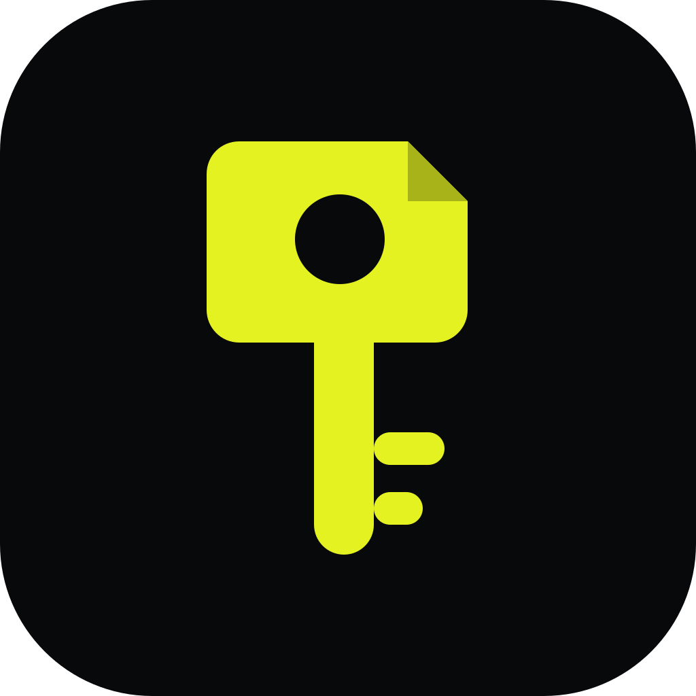

# Keyfold

**Every key, folded away safely.**

Keyfold is a local-first desktop vault for API keys. It is built for the moment a
provider shows you a secret exactly once: no accounts, no sync, no telemetry —
one encrypted file on your machine.



## What it does

- **Standard tier** — unlocked by your master password.
- **Critical tier** — needs a second, independent password entered after the
  first one, and closes again on its own timer.
- **Folders and keys** — group keys by provider or project, or keep them at the
  tier root. A folder can hold as many keys as you need.
- **Masked values** — secrets show a short hint only; Reveal and Copy are
  deliberate actions.
- **Search** — `Ctrl+K` searches labels and providers. Critical results appear
  only while the Critical tier is unlocked.
- **Portable backup** — export or import the encrypted vault file. There is no
  plaintext export in this version.

The interface is keyboard-first and stays out of the way. Its visual system —
void and carbon surfaces, graphite hairlines, tight Inter type and a single
acid-lime action color — is documented in [DESIGN.md](DESIGN.md). All secret
material and all cryptography live in the Rust backend; the webview only ever
receives a value it explicitly asked for.

## Requirements

- Windows 11 (primary target; the code base is cross-platform clean)
- [WebView2 runtime](https://developer.microsoft.com/microsoft-edge/webview2/)
  (preinstalled on current Windows 11)
- Node.js 20+ and npm
- Rust stable 1.77+ with the MSVC toolchain

## Run and build

```bash
npm install
npm run dev:desktop      # Tauri development window
npm run build:desktop    # release build + NSIS installer
```

The installer is written to `src-tauri/target/release/bundle/nsis/`.

Use `npm run dev` for the browser UI preview. Outside the Tauri runtime the
frontend falls back to an in-memory demo vault (`src/lib/preview-backend.ts`) so
screens can be reviewed without compiling Rust. That file is dev-only and is
never loaded in a release build.

## Tests and checks

```bash
npm run check        # typecheck, ESLint, Prettier, Clippy -D warnings, Rust tests
npm run test:rust    # 54 unit tests + the end-to-end command test
```

The Rust suite covers AEAD known-answer vectors, nonce uniqueness, AAD binding,
HKDF test vectors, Argon2 floors, both encryption schemes, tampering, swapped
ciphertexts, atomic writes and the vault file format. `src-tauri/tests/vault_flow.rs`
drives the real Tauri IPC surface: create a vault, add folders and keys in both
tiers, move a key across the tier boundary, lock, restart from disk, change a
password and unlock with the recovery key.

## Where the vault lives

`keyfold.vault` is stored in the OS app-data directory, next to a rolling
`keyfold.vault.bak`:

```
Windows: %APPDATA%\app.keyfold.desktop\keyfold.vault
macOS:   ~/Library/Application Support/app.keyfold.desktop/keyfold.vault
Linux:   ~/.local/share/app.keyfold.desktop/keyfold.vault
```

Settings → Data opens the folder and can export a copy. Writes go to a temporary
file in the same directory, are flushed, then renamed over the old file.

## Keyboard shortcuts

| Shortcut | Action |
| --- | --- |
| `Ctrl+K` | Search / command palette |
| `Ctrl+N` | Open the **+** menu |
| `Ctrl+L` | Lock the vault now |
| `Ctrl+Shift+L` | Lock only the Critical tier |
| `Ctrl+,` | Settings |
| `Esc` | Close a dialog or hide a revealed value |
| `Ctrl+C` on a focused key | Copy its value |

## Security

Read [SECURITY.md](SECURITY.md) for the threat model and the exact scheme, and
[DECISIONS.md](DECISIONS.md) for the implementation choices that are not spelled
out in the build plan.

The short version:

- Argon2id (256 MiB / 3 passes minimum, benchmarked per machine) derives a key
  from each password.
- Standard secrets use XChaCha20-Poly1305 inside an AES-256-GCM-wrapped item key.
- Critical secrets add a third layer and bind every ciphertext to the vault,
  entry, tier and format version with AEAD associated data.
- Both tiers auto-lock; the Critical tier locks on a shorter timer that only
  Critical actions extend. Copied values are removed from the clipboard after
  20 seconds, and immediately when the vault locks.
- Revealed values disappear when the window loses focus, and the window asks the
  OS to block screen capture by default where supported.
- The app makes no network requests and has no analytics, crash reporting or
  update pings.

If you lose both passwords and the recovery key, the data cannot be recovered.
Nobody can help, including the authors.

## Project layout

```
src/                 React 18 + TypeScript frontend
  app/               Onboarding, Unlock, Workspace, design page
  components/        UI primitives and the custom title bar
  features/          vault, critical gate, search, settings
  lib/               typed IPC wrappers, formatting, password strength
  store/             Zustand application store
src-tauri/           Tauri 2 shell and Rust backend
  src/crypto/        Argon2id, AEAD, HKDF hierarchy, layered encryption
  src/vault/         model, atomic storage, session and auto-lock
  src/commands.rs    the complete IPC command surface
  tests/             end-to-end command test
```

## License

MIT, as declared in `src-tauri/Cargo.toml`.
